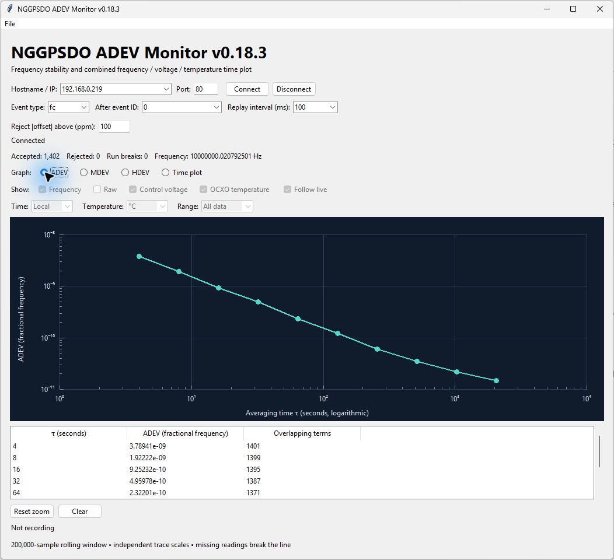
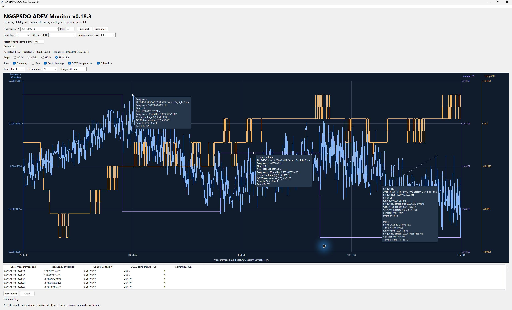

# NGGPSDO ADEV Monitor

NGGPSDO ADEV Monitor is an open-source desktop application for live monitoring
and frequency stability analysis of the NGGPSDO hardware device from
[Viewstreet Technologies](https://www.viewstreet.com/).

The application combines live Allan deviation (ADEV) graphing with direct replay
of historical measurements stored on the hardware. Users can reconnect and
review measurements collected over days or weeks, depending on the device's
configured retention and available storage, without leaving a computer connected
or first capturing a CSV file. Retained history is replayed over the network and
followed by live measurements in the same session.

Long-term history lets users investigate how frequency stability develops over
longer averaging times, identify stability floors and changing trends, and review
oscillator behaviour during warm-up and settling. Viewing frequency alongside
OCXO temperature and control voltage helps reveal correlations with thermal
conditions and controller activity. Historical replay also supports investigation
of intermittent disturbances and comparison of operating periods before and
after a restart or adjustment. Capture takes place on the hardware independently
of the application: the computer does not need to remain connected or running.
Users can connect later to retrieve and analyse the retained measurements.
These views help users assess repeatability and distinguish short-lived
fluctuations from sustained changes; correlations alone do not establish a cause.

The hardware's persistent measurement journal supports recovery across device
restarts and power cycles. The client reconnects automatically after connection
loss and requests continuation from its last received event within the active
session. Measurement gaps and restarts are treated as separate analysis runs,
so stability calculations do not bridge interruptions.

Modified Allan deviation (MDEV) and Hadamard deviation (HDEV) provide additional
views of frequency stability across averaging times. A combined time plot
displays frequency offset, OCXO temperature and control voltage, helping users
examine frequency behaviour alongside operating conditions.

Interactive zoom, pan and pinned measurement comparisons support detailed
inspection. Users can record measurements to CSV, reopen recordings for analysis,
and export graph data or SVG images for reporting and further investigation.
Analysis uses device measurement timestamps and separates discontinuous data into
independent runs.

Written in Python with a Tk desktop interface, the application requires no
third-party runtime packages. The current version is **0.18.3**.

## Screenshots



Live Allan deviation analysis of NGGPSDO frequency measurements, with logarithmic
axes, averaging times and overlapping term counts.



Live time plot with independent trace scales and pinned measurement comparisons.

## Run

### Windows portable application

Download `NGGPSDO-ADEV-Monitor-0.18.3-Windows-x64.zip` from
[GitHub Releases](https://github.com/viewstreetTechnologies/nggpsdo-adev/releases/latest),
extract the ZIP, and run `NGGPSDO-ADEV-Monitor.exe`. Python installation is not
required. The download includes the application license and bundled runtime
notices. This Windows x64 build is not code-signed.

### Run from Python source

Requires Python 3.10+ with Tk (included in the standard Windows installer).
No third-party runtime packages are needed. From this directory:

```powershell
python -m nggpsdo_adev
```

Alternatively install with `python -m pip install .` and run `nggpsdo-adev`.

## Connection

The compact Hostname / IP field is an editable dropdown. Connect remembers the
ten most recent validated addresses and their ports, including connection
attempts. Selecting a host restores its port; startup restores the latest entry.
History is stored in `%APPDATA%/nggpsdo-adev/hosts.json` on Windows, or
`~/.config/nggpsdo-adev/hosts.json` otherwise. Missing/corrupt history is ignored.

Enable `network.sse.enable` on the hardware and check the configured port
(default 80). Enter the device hostname or IP in **Hostname / IP** and its SSE **Port**
(default 80). The app builds the HTTP `/events` endpoint internally.
Select event type **fc**, or
**1** for older firmware that only accepts numeric IDs. Only `fc` events with
the firmware frequency-sample schema are analyzed.

Choose **Live only** for new measurements or **0** in After event ID for retained
history. A custom ID resumes after that ID. Replay interval is in milliseconds;
it affects delivery pacing, not measurement timing. Hostname and port are separate fields; the URL and query string are not shown. Automatic reconnect uses Last-Event-ID within the active
session. A fresh Connect clears the analysis window.

### Historical replay and recovery

With SD journaling enabled on the device, measurements are retained independently
of the desktop application. Select **0** in After event ID to replay available
history, or enter an event ID to continue after a particular point. Replay pacing
controls delivery speed; analysis always uses the original measurement timestamps.

Available hardware history depends on the configured journal retention and
storage. Histories spanning days or weeks can be replayed directly from the
device. The desktop analysis window holds
the latest 200,000 accepted samples (approximately 9.3 days of continuous
four-second measurements), rather than the entire device archive at once.

After a power cycle, the hardware recovers valid journal records and rebuilds its
index. Previously committed history remains available for replay; incomplete or
corrupt journal tails are discarded. Abrupt power loss can lose records not yet
flushed to storage, and no measurements are taken while the device is powered off.
The client separates discontinuities into independent analysis runs. Reconnecting
within an active client session uses its last event ID; after restarting the
application, select history replay again to retrieve retained measurements.

## Plot and display

Startup sizes the window from the controls' requested layout and current font
scaling, bounded by the screen work area. Minimum width keeps the control rows
readable; the graph can shrink vertically when resizing.

Click a point to pin its information label. Click additional points to compare
them against the nearest earlier pinned timestamp, independent of click order.
The earliest timestamp has no delta section.
Time deltas use days, hours, minutes and seconds as needed, retaining milliseconds
(for example `+1d 2h 3m 4.500s`). Multiple traces pinned at the same
timestamp share the nearest strictly earlier reference. Later labels include time,
frequency offset, voltage (mV) and temperature differences. Fahrenheit deltas
use the temperature difference, without adding 32. Matching smoothed pins also
show frequency-offset differences. Stability pins compare τ, deviation and its
ratio against the previous lower pinned tau within the same stability type.
Cross-run/nominal changes are identified; missing telemetry yields Unavailable.
References remain available outside the zoom; inserting another pin recalculates
the comparisons. Repeat clicks do not duplicate a label. Labels track points during updates
and use leader lines; the layout avoids overlap when space permits. Right-click
inside a pinned label to dismiss only that label; right-clicking elsewhere does
nothing. Delta references recalculate after removal. Clear removes all pins. Dragging still pans without
pinning. Pins outside the selected graph/visible traces/zoom are hidden and
reappear when their points are visible again. Clear removes pins. Saved SVG
images include pinned labels, while temporary hover tooltips are excluded.
Drag inside a pinned label to reposition it; its leader line stays attached to
the data point. Manual positions survive live redraws and zoom and are kept
inside the canvas. Dragging elsewhere still pans the plot. Removing a label or
clearing data also removes its saved position.

**Range** selects the latest 5 minutes, 30 minutes, 1 hour, 1 day, 1 week or All data, and
enables Follow live. Short recordings show the available history and grow toward
the selected span. Pan/wheel zoom changes the selector to Custom and pauses
following. Reset zoom selects All data. Range controls apply only to the time
plot; stability averaging-time zoom and the retained/exported data are unchanged.

Drag horizontally inside a zoomed plot to pan across retained data. Panning and
wheel zoom turn **Follow live** off on the time plot. Enable it to keep the
latest measurement at the right edge while preserving the current time span;
disable it to freeze the viewing window while acquisition continues. It follows
the latest received measurement during replay too. Reset zoom restores the full
view and enables Follow live. Stability graphs support pan/zoom independently.
Recording status below the buttons shows RECORDING, filename, elapsed duration,
and written sample count; otherwise it shows Not recording.

**Frequency** shows the hardware rolling average first; **Raw** (hidden by default) shows
four-second measurements. Both plot frequency offsets in Hz. Each trace has its
own show/hide checkbox. Client-side frequency smoothing has been removed.

Scroll up/down inside the graph to zoom the horizontal axis in/out, centered
on the cursor. Time plots zoom measurement time; stability plots zoom logarithmic
averaging time Ï„. Vertical scales auto-range over visible points. Double-click
the graph or use **Reset zoom** to return to the full live view. Each graph keeps
its own zoom range; time zoom stays fixed while Follow live is off. Tables and exports
retain the full window, independent of zoom.

Hover within nine pixels of a sample to see its measurement time, visible trace
values, sample/run and event ID. Time and temperature follow display preferences.
Stability points show averaging time Ï„, deviation and overlapping term count;
they do not represent an individual measurement timestamp. Hover also works on
dense traces without visible markers. Moving away or leaving the plot hides it.
Tooltips stay attached to their selected sample across live updates and rescaling;
stability tooltips follow the same Ï„ as its value updates. Hiding the trace,
switching graph, clearing data or expiry from the rolling window dismisses it.

- Frequency (hardware average) is blue, raw frequency is teal, control voltage purple, and temperature orange.
- Select **Local** (computer timezone, default) or **UTC** for axis/table times.
- Select **°C** (default) or **°F** for temperature axis/table values.
- Display choices do not alter acquisition timestamps or stored measurements.
- Independent vertical scales auto-range; equal screen heights do not imply
  equal numerical values. All traces use the same measurement-time axis.
- Missing readings and continuity breaks interrupt lines; missing telemetry is
  shown as Unavailable, never zero. Older streams without telemetry still work.
- The plot retains the latest 200,000 accepted frequency samples; the table
  shows the latest 100. Telemetry from rejected frequency samples is recorded
  to CSV but is not included in this accepted-sample plot.

The Graph selector offers **ADEV**, **MDEV**, **HDEV**, and **Time plot**.
Only the time-series views are condensed: Frequency, Raw, Control voltage,
and OCXO temperature share the Time plot with independent show/hide controls.
ADEV is the default view. Time/unit/trace controls are disabled while showing
stability graphs. Each stability graph uses logarithmic averaging time and
fractional-deviation axes, has a tau/deviation/term-count table, and exports
its stability results. Zero deviations appear in the table, not on a log axis.

## Recording and export

Recording, Open CSV, Export graph CSV and Save graph image are in the **File**
menu. **Save graph image** exports the current plot as a standalone SVG image,
including visible traces, scales and zoom, without transient tooltips. SVG opens
in modern browsers and scales for printing/sharing without an extra dependency.
Only Reset zoom and Clear remain as buttons below the graph.

**Record CSV** records future incoming measurements, including rejected ones,
until **Stop recording**. **Open CSV** imports a recording. **Export graph CSV**
exports the selected stability results or all currently visible time traces
from the retained window, with run IDs for time-series exports.
Missing telemetry is exported as blank cells. If all traces are hidden, export
contains timestamps and run IDs only. **Clear** clears analysis; recording
continues. Saved timestamps are always Unix UTC milliseconds and temperatures
are always Celsius, regardless of display preferences.

Optional telemetry fields `ocxoTemperatureC` and `controlVoltageV` require
firmware FC journal v3. Their validity flags are 64/128. Temperature is a fresh
read at callback processing time. Voltage is calculated from cached DAC settings
before that tick's controller adjustment, not an ADC reading or a gate average.
Manual OCXOs may not expose voltage. Older streams and recordings remain supported.

## Measurement rules

The input includes sampleNumber, endTimeUnixMs, intervalUs, frequencyHz,
nominalHz, and flags. Accepted measurements need Valid (1) and TimeValid (4),
no overflow/tolerance-exceeded flags (16/32), and frequency offset within the
configured absolute limit (default 100 ppm, applied on Connect).
Discontinuity (8), sample-sequence gaps, invalid measurements, nominal/gate
changes, or timestamp spacing outside the gate ±100 ms start a new run.
Network arrival timing is never used as acquisition timing.

GPS PPS reference noise and the GPSDO control loop contribute to measured
frequency fluctuations. Displaying a temperature plateau does not establish
frequency lock.

## Development

Windows executable build instructions are in [packaging/README.md](packaging/README.md).

```powershell
python -m unittest discover -s tests -v
```

Source repository: [viewstreetTechnologies/nggpsdo-adev](https://github.com/viewstreetTechnologies/nggpsdo-adev).

## License

This Python client is released under the [MIT License](LICENSE).
This license applies to this standalone client; firmware licensing is separate.

### Frequency traces

The **Frequency** checkbox shows the hardware's rolling averaged frequency
as an offset from nominal, updated every four seconds using the active filter window
(typically 16 minutes at L5). Its filter level is shown in point tooltips; its timestamp
is the raw sample's measurement-end time. This is the hardware value, not a Python
smoothing filter. Older firmware/CSV files show this trace as unavailable.
ADEV/MDEV/HDEV continue to use only the raw four-PPS samples.

FC journal format is v5 (80-byte payload; validity flag 256 for controller frequency).
The additional event/CSV fields are `controllerFrequencyHz` and `controllerFilterLevel`.
The monitor still reads old raw CSV files. Older device journal segments are
incompatible and are discarded by the existing recovery policy; export needed
history before installing the firmware.
